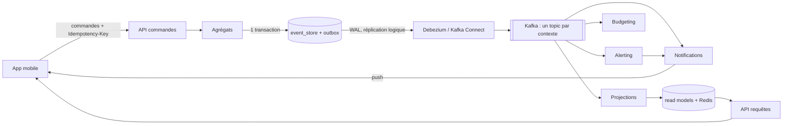

# PocketLedger

Backend d'une application mobile de finances personnelles : comptes, transactions, budgets, analytics et alertes intelligentes.
Kotlin, Spring Boot 3, CQRS + event sourcing, PostgreSQL, Debezium, Kafka, Redis, Testcontainers.

- **Exactitude financière** : soldes reconstructibles depuis les événements, réconciliation nocturne, montants en unités mineures.
- **API mobile-first idempotente** : toute écriture rejouable sans effet de bord (`Idempotency-Key`).
- **Données sensibles chiffrées** par utilisateur, effaçables par crypto-shredding (RGPD).
- **Toutes les devises ISO 4217**, consolidées dans une devise de référence, parités XOF/XAF fixes.
- **Alertes en quasi temps réel** : budget, dépense inhabituelle, solde bas, abonnement, doublon.

## Architecture



Une écriture est confirmée dès que ses événements sont dans l'event store. Les lectures sont éventuellement cohérentes,
avec une cible inférieure à 1 s. Seul l'event store fait foi : chaque read model se reconstruit en rejouant les événements.

### Modules

| Module | Rôle |
| --- | --- |
| `modules/shared-kernel` | `Money`, erreurs, ports entre modules (Kotlin pur) |
| `modules/events` | Contrats des événements de domaine (frontière publique) |
| `modules/platform` | Event store, outbox, snapshots, exécution des processeurs, idempotence, erreurs RFC 9457 |
| `modules/crypto` | Clés par utilisateur (envelope encryption), chiffrement de champs, index aveugles, crypto-shredding |
| `modules/fx` | Référentiel ISO 4217 (156 devises), taux quotidiens, conversion, parités fixes |
| `modules/identity` | Inscription, JWT ES256, refresh tokens rotatifs, appareils, préférences, suppression de compte |
| `modules/ledger` | Comptes, transactions, virements (saga), imports CSV/OFX, réconciliation |
| `modules/categorization` | Catégories, règles, détection des abonnements |
| `modules/budgeting` | Budgets mensuels, report, franchissement de seuils |
| `modules/analytics` | Dépenses, cashflow, évolution du solde, marchands (jOOQ + cache Redis) |
| `modules/alerting` | Règles d'alerte, flux in-app, notifications push |
| `app` | Composition Spring Boot, Kafka, Debezium, sécurité, migrations Flyway |

Un module métier ne dépend jamais d'un autre module métier. Il passe par les événements ou par les ports de
`shared-kernel`, et `ArchitectureTest` (ArchUnit) fait échouer le build sinon.

## Démarrer en local

Prérequis : JDK 21, Docker.

```bash
# 1. Infrastructure : PostgreSQL (wal_level=logical), Kafka (KRaft), Kafka Connect + Debezium, Redis
docker compose -f ops/docker-compose.yml up -d

# 2. Application (enregistre le connecteur Debezium au démarrage)
./gradlew :app:bootRun

# 3. Scénario de démo de bout en bout
./scripts/demo.sh
```

- API : http://localhost:8080 — OpenAPI : http://localhost:8080/swagger-ui.html
- Collection Bruno : dossier `bruno/` (ouvrir la collection, environnement `local`)

Stack complète avec observabilité (Grafana, Prometheus, Tempo, Loki via `grafana/otel-lgtm`) :

```bash
./gradlew :app:jibDockerBuild
docker compose -f ops/docker-compose.yml --profile full up -d
# Grafana : http://localhost:3000 — importer ops/grafana/pocketledger-dashboard.json
```

## Concepts clés

### Event sourcing et publication

- `event_store` est en append-only (un trigger refuse `UPDATE`, `DELETE` et `TRUNCATE`). La concurrence optimiste
  repose sur `UNIQUE (aggregate_id, version)`. Un conflit est rejoué 3 fois dans un point de sauvegarde, puis renvoie `409`.
- Chaque événement est écrit dans l'outbox **dans la même transaction**, puis la ligne est supprimée aussitôt.
  Debezium lit l'insertion dans le WAL et l'Outbox Event Router la publie sur `pocketledger.<contexte>.events.v1`.
  La clé Kafka est l'`aggregate_id`, ce qui garantit l'ordre des événements d'un même agrégat.
- Les consommateurs sont idempotents : un checkpoint `(processeur, agrégat, version)` est écrit dans la même
  transaction que le read model. Après 3 essais, un message en erreur part dans `pocketledger.<processeur>.dlq`.
- Snapshots tous les 100 événements, en JSON chiffré, traités comme un cache jetable (ADR-005).

### Idempotence (PRD §6.2)

| Situation | Réponse |
| --- | --- |
| Même clé, même corps | Réponse d'origine rejouée, en-tête `Idempotent-Replayed: true` |
| Même clé, autre corps | `422 idempotency-key-reused` |
| Même clé, requête encore en cours | `409 idempotency-request-in-progress` (verrou Redis 30 s) |
| Pas de clé | `400 idempotency-key-required` |

La requête et l'enregistrement d'idempotence sont validés dans la même transaction PostgreSQL : une perte de Redis
ne crée pas de doublon.

### Chiffrement et RGPD

- Libellés, marchands, notes, noms de comptes et emails sont chiffrés en AES-256-GCM avec une DEK par utilisateur,
  elle-même chiffrée par une clé maître (KEK).
- La recherche plein texte passe par des index aveugles HMAC sur les mots normalisés : le texte clair n'est jamais stocké.
- `POST /api/v1/me/delete` détruit la DEK. Les événements restent dans l'event store mais deviennent illisibles,
  et chaque projection purge ses lignes à réception de `UserKeyShredded`.
- `POST /api/v1/me/export` produit un export JSON complet, téléchargeable 24 h via un lien signé.

### Multi-devise

- Toute devise ISO 4217 active est acceptée. Un montant qui a plus de décimales que sa devise est refusé
  (`12,345 EUR`, `1500,5 XOF`).
- Les événements gardent la devise d'origine. Les vues consolidées convertissent au taux de la date de la transaction.
  Si le taux manque, la ligne est marquée « non convertie » plutôt que fausse.
- XOF et XAF utilisent la parité fixe de 655,957 pour 1 EUR, sans fournisseur de taux.
- Fournisseur de taux : HTTP générique (`FX_PROVIDER_URL`, format `{"base":"USD","rates":{…}}`). Saisie manuelle possible
  via `POST /api/v1/admin/fx-rates`.

## Tests

```bash
./gradlew ktlintFormat              # formatage automatique (à lancer avant le premier commit)
./gradlew ktlintCheck detekt -Plint.strict=true   # lint bloquant, comme en CI
./gradlew test                      # unitaires, propriétés (Kotest), ArchUnit, contrats d'événements
./gradlew :app:integrationTest      # Testcontainers : PostgreSQL + Kafka + Debezium + Redis (Docker requis)
./gradlew koverVerify               # couverture ≥ 80 % sur le domaine
./gradlew :modules:ledger:pitest    # mutation ≥ 70 %
k6 run load-tests/k6/transactions.js
```

Les tests d'intégration couvrent notamment :
- la chaîne complète commande → Debezium → Kafka → projection ;
- 50 envois concurrents de la même clé d'idempotence, qui ne créent qu'une seule transaction ;
- le crypto-shredding : aucune donnée lisible ne reste en base, dans le cache ou dans les projections ;
- la reconstruction d'une projection, identique à la projection construite en flux ;
- un budget alimenté depuis un compte en XOF qui déclenche une alerte.

Les schémas JSON des événements sont versionnés dans `contracts/events`. Un changement de format fait échouer
`EventSchemaContractTest`, sauf si `-Dcontracts.update=true` est passé et qu'un upcaster accompagne le changement.

## Déploiement de démo

Le déploiement cible une VM unique avec docker compose : Caddy en frontal (TLS automatique), secrets hors du dépôt.

```bash
./ops/scripts/generate-secrets.sh          # clés de chiffrement, paire JWT ES256, mots de passe
DOMAIN=api.exemple.com ./ops/scripts/deploy.sh
```

Sur `main`, la CI construit l'image avec Jib, la pousse sur GHCR et déploie en SSH si `DEPLOY_ENABLED=true`.
Le service `backup` fait un `pg_dump` chiffré quotidien : synchronisez `/backups` vers un stockage objet externe.

## Écarts assumés par rapport au PRD

- **Agrégat Compte + grand livre unique** (ADR-004) plutôt que deux agrégats, pour vérifier atomiquement solde, devise et répartitions.
- **jOOQ sans génération de code** (ADR-006) : DSL typé à la main sur les tables analytics, pour garder un build sans base de données.
- **Topic des alertes** : `pocketledger.alerts.events.v1`, nommé comme les autres par l'Outbox Event Router. La clé Kafka est l'identifiant de l'alerte.
- **Push** : adaptateur journalisé par défaut. L'adaptateur FCM (HTTP v1 + compte de service) s'ajoute en implémentant `PushSender`.

## Licence

Apache 2.0, voir `LICENSE`.
